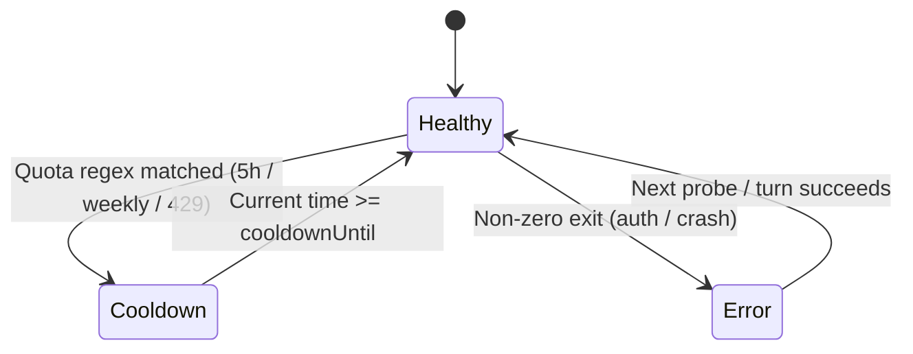

# `openclaw-sub` Technical Architecture

This document explains how `openclaw-sub` (`clawsub`) bridges [OpenClaw](https://openclaw.ai) to flat-rate subscription CLIs (`claude`, `codex`, `agy` / `gemini`, `ollama`) with zero per-token API cost and deterministic failover.

---

## 1. Design Principles

1. **Zero Upstream Forking:** `openclaw-sub` never patches or forks OpenClaw's core source code. It generates standard executable shims (`~/.openclaw/bin/clawsub-*`) and profile metadata so you can upgrade `openclaw` freely.
2. **Zero Runtime Dependencies:** Built strictly on Node.js standard library modules (`node:child_process`, `node:fs`, `node:path`, `node:os`, `node:test`) so `npx openclaw-sub init` runs in under a second with zero supply-chain bloat.
3. **0ms Cooldown Fast-Skip:** Once a provider reports a 5-hour or weekly quota limit, `clawsub` persists `cooldownUntil` in `~/.openclaw/clawsub-state.json`. Subsequent turns skip that provider in `0ms` without spawning a subprocess until the reset timestamp arrives.
4. **Heartbeat-Aware Quota Protection:** Background `[OpenClaw heartbeat poll]` turns are treated differently from live user messages:
   - During `quietWindows` (`23:00-08:00`) or `quotaReservationWindows` (`06:30-08:45`, `19:00-21:30`), heartbeats short-circuit to `NO_REPLY`.
   - If all subscription CLIs are in cooldown, heartbeats return `NO_REPLY` silently while live user messages receive a single human-readable status message with the earliest reset timestamp.

---

## 2. Failover & Cooldown State Machine

### Quota Detection & Reset Timestamp Parsing (`src/quota.mjs`)
Subscription CLIs report rate limits in several formats:
- **Claude Code CLI (5-hour window):** `{"type":"result","error":"usage_limit_reached: resets 6:50pm"}`
- **Claude Code CLI (Weekly window):** `You've hit your weekly limit. Resets Nov 28, 10:00am.`
- **OpenAI Codex CLI:** `HTTP 429 Too Many Requests` / `try again in 45 minutes`
- **Google Antigravity / Gemini CLI:** `ResourceExhausted: Quota exceeded`

`parseResetTime(output, now)` extracts:
1. Relative durations (`try again in 45 minutes`, `retry after 300s`).
2. Explicit calendar dates (`resets Nov 28, 10:00am`).
3. Time-of-day strings (`resets 6:50pm`), automatically rolling to the next calendar day when the target hour has already passed.

`computeCooldownUntil(output)` adds a configurable `cooldownBufferMinutes` (default `5` minutes) so `clawsub` doesn't race the provider's clock at the exact minute boundary.

---

## 3. Dual Integration Modes with OpenClaw

`clawsub init` generates two types of shims in `~/.openclaw/bin/`:

### Mode A: Unified Router Shim (`~/.openclaw/bin/clawsub-router`)
Point OpenClaw's CLI agent runner to `clawsub-router`. OpenClaw makes one call per turn, and `clawsub` internally walks the `chain` (`claude` → `codex` → `agy`), skipping any provider in cooldown and failing over transparently.

### Mode B: Native Per-Provider Shims (`clawsub-claude`, `clawsub-codex`, `clawsub-agy`)
Configure OpenClaw's native Primary Agent to call `~/.openclaw/bin/clawsub-claude` and OpenClaw's native Fallback Agent to call `~/.openclaw/bin/clawsub-codex` or `~/.openclaw/bin/clawsub-agy`.
Because each shim invokes `clawsub exec <provider>`, an exhausted primary provider immediately exits in `0ms` with a cooldown signal until its parsed reset time, allowing OpenClaw's native fallback handler to switch to the fallback provider without waiting for a network round-trip.
